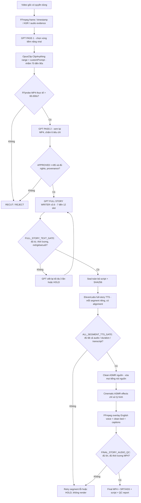

# LOCAL VIDEO FORGE v3.6 FINAL — FULL STORY COVERAGE & COMPLETE ELEVENLABS

**Trạng thái:** SPEC chuẩn duy nhất trong bundle v3.6; kế thừa GPT-first director + duration gate v3.5, sửa lỗi nghiêm trọng kịch bản chỉ có 1 mẩu voice.  
**Preset:** `CINEMATIC_ASMR` · **Audio mode:** `ENGLISH_STORYTELLING_WITH_CLEAN_ASMR` · **Input:** Đức/Hàn/Nhật/Trung/khác (không mặc định quốc gia)  
**Yêu cầu cứng:** Opus MP4 thực tế **> 65.000 giây**; GPT Pass 2 **APPROVED >=85** + QC bản quyền/bằng chứng; **chưa đủ English story + TTS = KHÔNG RENDER**.

## 1. LỖI GỐC Ở v3.5 VÀ CÁCH SỬA

Khi xem code v3.5:

- `storytelling_contracts_v33.py` chỉ đòi `narration_segments` **không rỗng**; 1 đoạn ~3 giây vẫn hợp lệ.
- Renderer `storytelling_render_v33.py` duyệt **tất cả segment nhận được**, không tự tạo voice cho các phần còn thiếu. Nếu GPT/adapter chỉ lưu 1 phần vào JSON, video cuối có đúng 1 phần.
- Spec cũ nói tạo kịch bản nhưng **không có adapter bắt buộc tạo đủ nội dung trên timeline**, và không có gate xác thực từng file TTS đã đủ độ dài.
- File mẫu cũ có **duy nhất một narration segment**; đây là anti-pattern trong video >65 giây.

v3.6 thiết kế lại thành ba chốt `FULL_STORY_TEXT_GATE` → `ALL_SEGMENT_TTS_GATE` → `FINAL_STORY_AUDIO_QC`. Không chỉ dựa vào prompt “hãy viết dài hơn”.

## 2. TOÀN BỘ LUỒNG (GPT ĐIỀU KHIỂN TRƯỚC & SAU OPUS)



**Quan trọng:** OpusClip có thể chọn trong vùng thời gian GPT đưa ra mà không frame-exact, nên vòng GPT review vẫn bắt buộc. Model chỉ thấy những khung hình/âm thanh/ASR thực sự được đưa cho nó; không giả định từ URL YouTube mà đã “xem hết” video.

## 3. FIX FULL STORY: MỘT KỊCH BẢN CHO GẦN TOÀN BỘ CLIP

### 3.1 GPT phải viết theo slot, KHÔNG trả về một câu ngắn

`full_story_writer_v36.py` dùng `suggest_slots(actual_duration)` tạo **7–12 khung kể chuyện có start/end** (phân bố đều từ ~0.8s đến ~duration-2s). GPT chỉ viết nội dung cho **mọi** `story_001`...`story_N`, còn timestamp là từ Python kiểm soát.

- Video 70 giây: ~8 đoạn, mục tiêu khoảng **120–145 từ**, có hook, quá trình, giải thích kỹ thuật, đoạn kết.
- Phải có phần lời ở đầu video và gần cuối; không dồn voice vào 5–10 giây đầu.
- Chừa khoảng trống giữa các đoạn để giữ tiếng búa/máy mài thực, không nhồi voice 100% thời lượng.
- Không bịa xuất xứ, độ cứng, thép Damascus hay thao tác không có bằng chứng. Nếu chưa đủ dữ kiện để kể nhiều đoạn có giá trị → `HOLD`, không tự chế nội dung để đạt số từ.
- Khi GPT trả sai/thiếu một slot, thiếu bằng chứng hoặc kịch bản quá ngắn: yêu cầu viết lại (tối đa 3 lần); thất bại → `STORY_GENERATION_FAILED_AFTER_RETRIES`, không phát lệnh TTS.

### 3.2 Hard gates (áp vào MP4 đã thực đo)

`story_coverage_v36.py` tính:

| Hạng mục | Chính sách v3.6 mặc định |
|---|---|
| Số đoạn voice | ≥5 (writer mặc định 7–12), tối đa 18 |
| Tổng chữ tiếng Anh | ≥ `ceil(duration_sec × 1.52)`, ≤ `floor(duration_sec × 3.3)` |
| Planned voice slot coverage | ≥64% và ≤93% duration |
| Hook xuất hiện | Segment đầu bắt đầu ≤5 giây |
| Kết | Slot cuối kết thúc trong ≤8 giây trước video kết thúc |
| Khoảng cách giữa các slot | Không quá 13 giây |
| Mỗi segment | ≥6 từ; mật độ ≤3.9 từ/giây slot |
| Script integrity | `script_en.txt` = N segment theo thứ tự và `script_tts.txt` = cùng N segment |
| Tính bất biến | Hash video/plan/full script/TTS script phải khớp bản `story_coverage_v36.json` |

**Ví dụ 70 giây**: 100 từ quá ngắn (ngưỡng 107), 1 đoạn dù có 150 từ vẫn bị chặn; 8 đoạn/129 từ phân bố trên 70s có thể đạt. Các ngưỡng là cấu hình chất lượng nội bộ, không là bằng chứng viral/TikTok eligibility.

**Vì sao không yêu cầu giọng Anh kéo đúng 100% video?** Mục tiêu bạn chốt là **English storytelling + Clean Workshop ASMR**. Tiếng búa cần được nghe riêng trong những khoảng nghỉ; giọng kể phải đủ toàn video chứ không liên tục không ngừng.

### 3.3 Kịch bản chuẩn nguồn duy nhất

Đối với từng clip approved:

```text
clip_001/
├── clip.mp4
├── story_plan.json           # N narration_segments, time slots, evidence_refs
├── script_en.txt             # nguyên văn full script tất cả segments
├── script_tts.txt            # nguyên văn full text gửi TTS, N segments
├── script_en.md              # bản đọc/edit của editor
├── story_coverage_v36.json   # hashes + plan coverage + word count
├── audio/tts/
│   ├── story_001_...mp3
│   ├── story_001_....alignment.json
│   ├── story_002_...mp3
│   └── ... TẤT CẢ segments
├── tts_full_story_v36.json   # kiểm tra spoken coverage sau TTS
├── audio/replacement_qc.json
├── audio/workshop_clean.wav  # khi nguồn có tiếng nói
├── captions_en.srt
├── captions_en.ass
├── final.mp4
└── qc_report.json
```

Nếu tool/worker sửa `story_plan.json` hoặc script sau khi duyệt, hash không khớp → phải duyệt lại; không dùng voice cũ khi nội dung đã khác.

## 4. TTS ELEVENLABS ĐỦ TOÀN BỘ KỊCH BẢN

`elevenlabs_full_story_v36.py`: tách mỗi segment thành một API call `text-to-speech/{voice_id}/with-timestamps` khi bật `--execute`, sử dụng `voice_id`/`tts_model_id` của plan (`QIhD5ivPGEoYZQDocuHI`, `eleven_multilingual_v2` theo v3.3). **Đây chỉ là defaults cũ, phải kiểm tra voice có thực sự tồn tại trong tài khoản**.

- **Trước bất kỳ lệnh có tính phí:** kiểm tra lại FFprobe >65s, GPT approval/rights + `require_sealed_script()`.
- Xuất file `.mp3` và `.alignment.json` **riêng từng segment**; các file định danh bằng hash text/role. Không tuyên bố “TTS complete” chỉ vì segment đầu thành công.
- Retry riêng segment lỗi; nếu một audio hoặc alignment vắng mặt, toàn clip **không được render**.
- So khớp từng ký tự alignment với `text_en` gốc. Số từ thực và audio length của từng segment phải hợp lý; chặn voice quá ngắn/bị cắt cuối hoặc dài quá slot.
- Tính tổng audio thực tế (`sum(ffprobe(TTS_piece))`): **≥59% clip**, voice phải có ở gần cuối (cách cuối ≤10s) và gap thực không quá 14s. Đây là QC bổ sung sau khi tạo voice, không dùng kế hoạch giả định để thay thế.
- Nếu TTS quá dài hoặc quá ngắn, xử lý lại script/slot/duration, không chỉ thêm silence vào voice để lách chỉ tiêu. **Không tự kéo dài tiếng nói bằng silence hoặc stretch nhân tạo**.

**Lưu ý thực tế:** API ElevenLabs chưa được kiểm chứng end-to-end bằng credit thật trong bản này. Cần kiểm tra timestamp/normalization với voice thực: khi normalization làm khác script (số/ký hiệu), ưu tiên sửa văn bản hoặc alignment một cách có xác thực, không bỏ gate để “cho qua”.

## 5. RENDER: KHÔNG MẤT GIỌNG, KHÔNG MẤT ASMR

- `storytelling_render_v36.py` là **entrypoint mặc định**. Nó chạy `require_sealed_script` trước, `verify_all_tts` sau, rồi gọi renderer legacy đã có gate v3.6.
- `storytelling_render_v35.py` và `storytelling_render_v33.py` trong bundle **cũng đã gọi gate v3.6** để chặn bypass. Không chạy mã legacy lấy trực tiếp từ ZIP cũ.
- Renderer tiếp tục dùng toàn bộ clean workshop bed, **không duck/mute nền khi ElevenLabs nói**.
- Giữ phụ đề tiếng Anh **Inter Bold/ tương đương, 54px trên 1080x1920, vị trí Y=85%, 1–4 từ/cue**. SRT + ASS được sinh từ English voice alignment và burn-in vào MP4.
- `SMART_EFFECT_PLANNER` Cinematic ASMR: zoom nhẹ tối đa 1.05x, màu vừa phải chỉ trên hình; không tự thay timeline làm lệch tiếng búa.
- `final_story_qc_v36.py`: so final duration với clip (≤0.25s sai số), số segment report phải khớp plan, `audio/english_voice_only.wav` có năng lượng tiếng ở **tất cả** slot, có subtitles.
- Không auto publish. Các báo cáo QC tự động **không chứng minh** đã xóa tuyệt đối tiếng nguồn hay bảo đảm đủ quyền sử dụng: cần nghe duyệt trên footage thật.

## 6. CLI HOẠT ĐỘNG (TRONG THƯ MỤC PACKAGE)

```bash
python -m pip install -r requirements.txt
# FFmpeg/FFprobe phải nằm trong PATH.

# 0. Từ v3.5: GPT chọn -> Opus cắt -> kiểm tra duration -> GPT duyệt clip, chỉ APPROVED.
python director_workflow_v35.py gate --clip-folder /work/clips/clip_001

# 1. Tạo kịch bản N segment từ video clip THẬT, cần story_plan.json làm seed,
#    evidence_manifest.json từ exported clip, và OPENAI_API_KEY hợp lệ.
python full_story_writer_v36.py generate --folder /work/clips/clip_001 --model YOUR_AVAILABLE_GPT_MODEL
# Chạy thật (có thể tính phí model):
python full_story_writer_v36.py generate --folder /work/clips/clip_001 --model YOUR_AVAILABLE_GPT_MODEL --execute

# 2. Kiểm tra/chứng nhận kịch bản
python story_coverage_v36.py gate --folder /work/clips/clip_001
python director_workflow_v35.py tts-handoff --clip-folder /work/clips/clip_001

# 3. ElevenLabs: dry-run liệt kê số đoạn, KHÔNG tốn credit
python elevenlabs_full_story_v36.py generate --folder /work/clips/clip_001
# Tạo voice THẬT, cần ELEVENLABS_API_KEY, mỗi segment riêng:
python elevenlabs_full_story_v36.py generate --folder /work/clips/clip_001 --execute
python elevenlabs_full_story_v36.py check --folder /work/clips/clip_001

# 4. Sau khi đã có Clean ASMR approved, audio replacement QC:
python storytelling_render_v36.py check --folder /work/clips/clip_001
python storytelling_render_v36.py process --folder /work/clips/clip_001
```

**Chặn tốn credit:** bước 3 **phải** được gọi qua runner v3.6; mọi adapter TTS bên ngoài phải gọi `director_workflow_v35.tts_handoff()` và `story_coverage_v36.require_sealed_script()` trước request đầu tiên. Không sử dụng pipeline v3.5 trực tiếp để tạo voice.

## 7. ACCEPTANCE TEST BẮT BUỘC

- Một clip 70s, script có 1 đoạn 3s → `STORY_TOO_SHORT`, không gọi TTS.
- Script có 8 đoạn nhưng tổng 30 từ → `STORY_TOO_SHORT`.
- Script có nhiều từ nhưng không có lời gần cuối → `STORY_END_TOO_EARLY`.
- `script_tts.txt` chỉ là một mẩu của full script → `TTS_SCRIPT_INCOMPLETE`.
- Xóa hoặc thiếu 1 trong 8 TTS files → `TTS_INCOMPLETE`, không render.
- TTS bị cắt ngắn → `TTS_TRUNCATED_OR_TOO_FAST` hoặc `TTS_COVERAGE_TOO_LOW`.
- English alignment không khớp text → `NEEDS_CAPTION_ALIGNMENT`.
- Thay plan/script sau khi đóng dấu → `STORY_STALE_OR_CHANGED`.
- Clip ≤65s hoặc chưa GPT-approved → chặn như v3.5.
- Clip nguồn Hàn/Nhật nhưng country chưa được xác minh → không bịa quốc gia.
- ASMR bed tiếp tục dưới mọi câu tiếng Anh; chữ sub khớp English.
- Offline smoke 70s có 8 segment, đủ spoken-coverage, output MP4/ASS, background audio không duck.

## 8. TRẠNG THÁI TEST & GIỚI HẠN THỰC

Đã chạy thành công tại thời điểm build:

- **31/31 unit + regression tests** (v3.5 duration approvals + v3.6 story completeness).
- **1/1 FFmpeg end-to-end offline smoke**: video thử 70.0s, 8 synthetic audio segments, ~75.5% TTS coverage, có MP4 xuất và ASMR/background layer liên tục.
- Chưa chạy live GPT/OpusClip/ElevenLabs/SAM Audio trên source người dùng trong build này. Audio giả lập không đánh giá được sự tự nhiên của ElevenLabs, độ sạch giọng nguồn, hay độ hấp dẫn nội dung thực.
- Logic tối thiểu `>=1.52 word/sec` chỉ bảo đảm độ phủ; **không bảo đảm lời kể hay**. Cần người biên tập duyệt script và nghe output thật.

## 9. FILE BẮT BUỘC CHO CODING AGENT

`README_FIRST.md` → `SPEC_Local_Video_Forge_v3.6_FINAL_FULL_STORY.md` → `full_story_writer_v36.py` → `story_coverage_v36.py` → `elevenlabs_full_story_v36.py` → `storytelling_render_v36.py` → `final_story_qc_v36.py`.

**Mọi SPEC v3.2–v3.5 trong `legacy_docs/` chỉ dùng tham khảo lịch sử. Chính sách v3.6 ghi đè mọi hướng dẫn có thể cho qua kịch bản quá ngắn hoặc chỉ 1 narration segment.**
