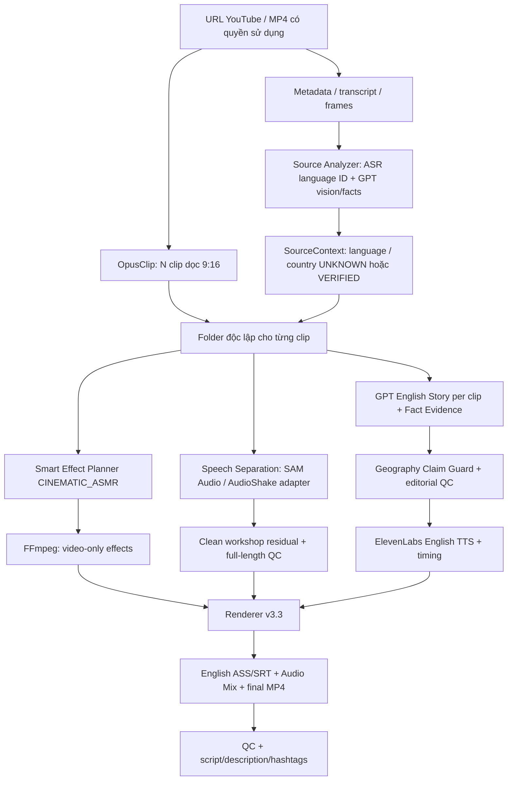

# LOCAL VIDEO FORGE — SPEC v3.3 FINAL PATCH: UNIVERSAL SOURCE + CINEMATIC ASMR

**Ngày:** 2026-10-17  
**Nền tảng:** v3.2 Cinematic ASMR + v3.1 Clean ASMR  
**Phạm vi:** cập nhật hợp đồng nguồn, lời kể, audio QC và renderer offline. **Không phải ứng dụng full-automation một nút**.  
**Trạng thái:** Python schema, renderer, migration, QC, ASR-evidence normalizer đã có code. API adapters YouTube/OpusClip/OpenAI/ElevenLabs/SAM Audio/AudioShake **chưa được nối live trong bộ này**.

---

## 0. Quyết định không được thay đổi

1. **Universal Source:** video có thể đến từ Đức, Hàn Quốc, Nhật Bản, Trung Quốc, Việt Nam hoặc nguồn không xác định. **KHÔNG** mặc định Đức.
2. **SOURCE_LANGUAGE != SOURCE_COUNTRY.** Có tiếng Hàn không chứng minh xưởng ở Hàn Quốc. Có tiếng Nhật không chứng minh người thợ hoặc xưởng ở Nhật.
3. **No invented provenance:** chỉ kể quốc gia/thành phố/vùng khi đã có bằng chứng nguồn, reviewer xác minh, `source_country_status=VERIFIED`. Nếu không, `source_country=null`, `UNKNOWN`, kịch bản tập trung vào quy trình.
4. **Clean ASMR:** loại bỏ **toàn bộ lời nói nguồn** (tiếng Đức/Hàn/Nhật/Trung/Anh, kể cả nhiều ngôn ngữ) xuyên suốt track audio, không dùng cách mute/duck toàn bộ nền ở cửa sổ voice.
5. **English independent storytelling:** GPT viết câu chuyện mới cho từng clip từ khung hình + sự kiện nguồn; không dịch/lồng tiếng câu đối câu.
6. **ElevenLabs:** TTS Anh-Mỹ, khóa voice ID `QIhD5ivPGEoYZQDocuHI` theo cấu hình đã chọn (cần xác minh voice ID hợp lệ trong tài khoản). Mặc định model `eleven_multilingual_v2`.
7. **ASMR always-on:** tiếng búa/mài/máy chạy đồng thời với lời kể Anh, không auto-duck theo TTS. Nếu separation làm mất transient, FAIL QC.
8. **CINEMATIC_ASMR:** video-only zoom tối đa 1.05x + color grading nhẹ; không đổi timecode. Các hook recut, speed-ramp, B-roll, before/after chưa có auto-render.
9. **English subtitles:** Inter Bold, cỡ ~54 px ở 1080×1920 (`width*0.05`), Y=85%, 1–4 từ/cụm, tạo từ alignment TTS, export `.srt`, `.ass` và burn vào MP4.
10. **One source → N OpusClip clips → N work folders**, kịch bản, TTS, subtitles, final và publication pack riêng. Phải xác minh quyền sử dụng footage và quyền nhạc.

## 1. Lỗi v3.2 và thay đổi v3.3

| v3.2 — lỗi/giới hạn | v3.3 — fix |
|---|---|
| `german_speech_status` | `source_speech_status` |
| `source_german_speech` / `text_de` | `source_speech[]` với `language`, `transcript`, timestamp |
| `german_voice_absent` trong QC | `source_voice_absent` cho **mọi** tiếng nói |
| Prompt dễ giả định người Đức | `SourceContext` + prompt Universal Source + guard quốc gia |
| Không có bằng chứng quốc gia trong plan | `source_country`, `source_country_status`, `country_evidence_refs`, `country_reviewed_by` |
| Ngôn ngữ nguồn gắn logic cố định | `source_language`, `source_language_status`, `language_evidence_refs`; `und` khi chưa xác định |
| Không có quy trình dữ liệu cũ | `migrate_v32_to_v33.py`: tạo bản dự thảo, **reset QC**, chặn render tới khi kiểm lại |
| Không kiểm tra bịa địa danh | `story_claim_guard_v33.py`: cảnh báo/chặn từ khóa địa lý phổ biến trong lời kể, script và description |

**Điểm đặc biệt:** Quốc gia và ngôn ngữ có hai cơ chế xác minh khác nhau. Một kết quả ASR `ko` không bao giờ tự ghi `source_country=KR`.

## 2. Sơ đồ pipeline



**Phụ thuộc:** Không tạo TTS trước khi script pass nguồn/fact guard; không render final nếu không có approved bed hoặc xác minh audio nguồn không có lời; không speed-warp clip sau khi chốt voice/sub/timecodes.

## 3. SOURCE ANALYZER — hiểu nguồn bất kỳ

### 3.1 Input cần cung cấp cho model/adapter

- URL, title, description, tên kênh, giấy phép và thông tin tác giả có thể kiểm tra.
- Clip 9:16 thực tế và các khung hình có timecode (FFmpeg extract); không giả định model xem trực tiếp được toàn bộ URL YouTube.
- Transcript từ OpusClip/ASR có **đúng timeline**; nếu transcript từ video dài, phải có time-map để đồng bộ clip đã reorder.
- Ngôn ngữ thực sự nghe được theo kết quả ASR/language-ID (có thể `mul`/`und`).
- Fact sheet kỹ thuật và hình ảnh có ID bằng chứng: `frame_00:04.2`, `transcript_...`, `official_channel_...`.

### 3.2 Kết quả bắt buộc

```json
{
  "source_language": "ko",
  "source_language_status": "CONFIRMED",
  "language_evidence_refs": ["whisper_ko_lang_id_clip01"],
  "source_country": null,
  "source_country_status": "UNKNOWN",
  "country_evidence_refs": [],
  "country_reviewed_by": null,
  "topic_en": "Knife forging and polishing",
  "verified_facts": [
    {"claim_en":"A blade is being polished on screen","evidence_refs":["frame_0014"]}
  ]
}
```

`source_language` dùng mã BCP-47, như `de`, `ko`, `ja`, `zh`, `en`; `und` khi thiếu bằng chứng. Với nhiều thứ tiếng trong một clip, từng đoạn `source_speech[].language` có thể khác nhau. Nếu ngôn ngữ không xác định, vẫn cần xóa **mọi** giọng người nghe được.

### 3.3 Xác minh country

- `VERIFIED`: country code ISO 3166-1 alpha-2 + `country_evidence_refs` + `country_reviewed_by` không rỗng. Chứng cứ có thể đến từ chính người quay/xưởng, danh mục chính thức hoặc thông tin địa điểm được xác thực.
- `UNKNOWN`: quốc gia `null`, refs rỗng; **không** suy diễn từ ngoại ngữ, tiêu đề có chữ Hàn, ngoại hình, tên kênh, kiểu dao hoặc máy.
- Nếu lời kể nói `German`, `Germany`, `Korean`, `Seoul`, `Japanese`, `Tokyo`, v.v. khi `source_country=UNKNOWN`, offline guard sẽ chặn một số chuỗi đã có trong từ điển và yêu cầu sửa. Guard là một **bộ lọc từ khóa giới hạn**, không thay thế fact checker/người duyệt (nó không nhận hết tên tỉnh, thành phố hay lối viết ẩn dụ).
- Nếu có country verified, guard vẫn chặn việc nhắc quốc gia **khác** mà chưa có căn cứ; trường hợp so sánh có chủ đích cần review và viết lại nội dung phù hợp với phạm vi phát hành.

### 3.4 Prompt mẫu

- `examples/source_analysis_prompt_v33.md`
- `examples/english_storytelling_prompt_v33.md`

Có script `source_profile_from_asr_v33.py` để chuẩn hóa output JSON **từ một model ASR đã chạy ở nơi khác**; nó không tự chạy ASR, không tự download YouTube. Confidence mặc định ≥ 0.85 (heuristic, không phải xác nhận tuyệt đối): thiếu evidence, confidence thấp → `und`.

## 4. OPUSCLIP & BATCH

1. Nhập video có quyền sử dụng và gọi OpusClip (adapter upstream **chưa nằm trong ZIP**).
2. Import các `.mp4` xuất từ OpusClip bằng `ingest_opus_batch_v33.py --clips-dir ... --output-root ... --rights-reviewed`.
3. Bỏ qua file MP4 trùng **SHA-256 chính xác trong lần import**. Chưa có perceptual dedup nhiều cảnh hoặc so khớp kho lịch sử.
4. Mỗi clip có `story_plan.json` v3.3 của riêng mình; nguồn context có thể giống nhau nhưng `protected_asmr`, narration/evidence/timing phải căn theo mỗi clip.
5. Không nối giờ từ video dài sang clip nếu không có `source_to_clip_time_map` đáng tin cậy.

## 5. Tách toàn bộ tiếng nói nguồn — Clean ASMR

**Input:** `clip.mp4` source audio, ASR/transcript (nếu có), speech detection và ASMR markers.  
**Adapter dự định:** SAM Audio/AudioShake hoặc tương đương. **Bộ code này không có API tách giọng live.**  
**Output:** `audio/workshop_clean.wav` không còn ngôn ngữ nguồn, đủ chiều dài track, giữ búa/máy/mài.

### 5.1 Source speech gate

- `CONFIRMED_PRESENT`: buộc dùng clean residual full-length, `approved_workshop_stem_path`, `workshop_stem_qc_passed=true`, `audio/replacement_qc.json` pass. Không bao giờ dùng raw thay nền trong khoảng voice nghỉ.
- `CONFIRMED_ABSENT`: chỉ dùng audio gốc sau khi `source_speech_absence_confirmed=true` và reviewer đã nghe kiểm tra; không cần tách giọng.
- `UNCERTAIN`: chặn render, yêu cầu kiểm tra. **Empty SRT không chứng minh speech absence.**

### 5.2 replacement_qc.json

```json
{
  "reviewed_by": "reviewer-id",
  "source_sha256": "<sha256 clip.mp4>",
  "residual_sha256": "<sha256 workshop_clean.wav>",
  "source_voice_absent": true,
  "asmr_preserved": true,
  "clip_transcript_checked": true,
  "source_speech_absence_confirmed": false
}
```

- `source_voice_absent` áp dụng **mọi** giọng Đức/Hàn/Nhật/Trung/Anh, kể cả giọng rất nhỏ và đoạn giọng chen tiếng búa.
- QC có file hashes để phê duyệt mất hiệu lực khi file thay đổi; phải nghe kiểm tra bằng tai trong đoạn giọng trùng tiếng máy.
- Renderer so sánh RMS và audio transient ở đoạn ASMR được đánh dấu, kiểm tra không mất tiếng búa. Đây là cảnh báo tín hiệu, không phải máy tự chứng nhận chất lượng separation.
- Nếu không clean được mà giữ ASMR, trạng thái `NEEDS_AUDIO_REVIEW`, **không** tự mute tiếng xưởng.

## 6. ENGLISH STORYTELLING PER CLIP

**System model dự kiến:** GPT model mà bạn chọn và được API account cấp quyền (v3.2 đặt tên “GPT-5.6 Sol” trong spec cũ; cần xác minh model ID/API thực tế khi tích hợp). API connector chưa triển khai trong ZIP.  
**Input:** frame timeline, audio/action markers, source context, fact/evidence map, optional transcript; nguồn `und` và `UNKNOWN` phải xử lý bình thường.

**Các điều kiện:**

- Kể một câu chuyện tiếng Anh độc lập của chính clip, không song song dịch câu từ source-language.
- Không nói “German workshop”, “Korean blacksmith”, “Japanese master” khi không có bằng chứng.
- Không đoán nhiệt độ, loại thép, xuất xứ người thợ hay giá món đồ. Với Damascus, chỉ tuyên bố nếu có dữ kiện xác thực.
- `narration_segments[]`: `id`, `role`, `start`, `end`, `text_en`, `audio_path`, `evidence_refs` (không rỗng). Timeline không dựa theo vị trí source-language speech.
- `script_tts.txt` **chỉ** chứa lời ElevenLabs đọc. Tất cả captions phải được tạo bằng timestamps đúng của TTS ấy.
- Prompt phải tạo `description.txt` và `hashtags.txt` dựa trên clip, không bịa người thợ hoặc quốc gia.
- `story_claim_guard_v33.py`: check narration lúc validate, và `script_en.md`/`script_tts.txt`/`description.txt` khi có file. Cần thêm review nội dung bởi người vận hành vì regex không đủ để fact-check toàn bộ.

## 7. ELEVENLABS + SUBTITLE + AUDIO MIX

**Voice:** `QIhD5ivPGEoYZQDocuHI` (verify API entitlement), model `eleven_multilingual_v2` theo lựa chọn trước đây. `audio/tts/{segment}.wav` kèm `{segment}.alignment.json` từ ElevenLabs timestamps/alignment; script phù hợp exact text, không dùng word-timing giả tạo. N voice riêng cho N clip.

**Audio law:**

```text
workshop_bed = approved_full_length_clean_residual  (if source speech present)
           OR reviewed_original_audio             (if speech absent)
english_voice = individually timed ElevenLabs narration
mix = workshop_bed + english_voice
# NO speech-keyed ambience duck, NO -8dB bed clamp, NO source speech windows in mix
# master peak protection; reject if ASMR would be excessively reduced
```

**Subtitle:** `Inter Bold`, 54 px at 1080px width, Y=85% default, 1–4 words/cue, <=28 characters by default, output English SRT + ASS burn-in. Font substitution must be verified on deployment. Safe Y bounds 68–90%, per-shot optional `caption_regions.json`.

**Artifacts debug:** `audio/workshop_bed_always_on.wav`, `audio/english_voice_only.wav`, `audio/english_mix.wav`, `captions_en.srt`, `captions_en.ass`, `final.mp4`, `qc_report.json`.

## 8. SMART_EFFECT_PLANNER — CINEMATIC_ASMR (giữ từ v3.2)

**Code đã có:** `smart_effect_contracts_v32.py`, `smart_effect_planner_v32.py`, `smart_effect_render_v32.py`.

- **Micro-Zoom** `peak_scale<=1.05`, mặc định `1.045`, zoom vào các khoảng `protected_asmr` có reviewer/source timestamps.
- **Color grading** contrast/saturation nhẹ có giới hạn từ schema, không làm mất sắc kim loại/lửa.
- Output effect video-only `effects/video_effects.mp4` (không có audio). Hash source clip, timebase, duration và plan phải hợp lệ; nếu outdated → fail-closed.
- **Chỉ gợi ý/chưa tự auto recut:** Result-First Hook, Action-Matched Cut, Speed Ramp, B-roll, Before/After, Seamless Loop. Muốn làm phải recut upstream rồi cập nhật time-map, clean audio và TTS/sub tương ứng.

Không dùng masking nhiễu, speed tweak/mirror/drop-frame với mục tiêu né máy phát hiện nội dung trùng. Editing không tự biến footage thành nội dung nguyên bản hoặc miễn trừ bản quyền.

## 9. Schema & interfaces

### story_plan.json — rút gọn

```json
{
  "schema_version":"3.3",
  "clip_uid":"clip_ko_001",
  "mode":"ENGLISH_STORYTELLING_WITH_CLEAN_ASMR",
  "rights_status":"VERIFIED",
  "music_rights_status":"NO_MUSIC",
  "source_context":{
    "source_language":"ko",
    "source_language_status":"CONFIRMED",
    "language_evidence_refs":["asr_001"],
    "source_country":null,
    "source_country_status":"UNKNOWN",
    "topic_en":"Knife forging"
  },
  "source_speech_status":"CONFIRMED_PRESENT",
  "source_speech":[{"id":"utt_01","start":4.2,"end":7.3,"language":"ko","transcript":"..."}],
  "protected_asmr":[{"start":8.0,"end":10.5,"kind":"hammer"}],
  "narration_segments":[{"id":"s_01","role":"hook","start":0.5,"end":3.3,
                         "text_en":"Every strike slowly takes shape.","evidence_refs":["frame_014"]}],
  "approved_workshop_stem_path":"audio/workshop_clean.wav",
  "workshop_stem_qc_passed":true,
  "settings":{"voice_gain_db":0,"peak_ceiling_dbfs":-1},
  "voice_id":"QIhD5ivPGEoYZQDocuHI",
  "tts_model_id":"eleven_multilingual_v2"
}
```

Use complete strict schema `storytelling_contracts_v33.py` and real verified timestamps; JSON above is an illustrative input shape, not a completed/renderable project.

### Model output / context normalization

```bash
python source_profile_from_asr_v33.py \
  --input examples/asr_detection.korean.example.json \
  --output /tmp/source_context.json
```

Consumes **existing ASR evidence JSON**, does not run Whisper itself or imply that an ASR score reliably proves a language. Model connectors should materialize the fields in the `source_context` of each clip plan.

## 10. Cấu trúc thư mục từng clip

```text
batch_root/
  render_preferences.json
  clip_001/
    clip.mp4
    import_manifest.json
    story_plan.json               # schema v3.3
    effect_plan.json              # schema effects v3.2 (unchanged)
    analysis/source_context.json  # optional separately saved SourceContext
    audio/
      workshop_clean.wav
      replacement_qc.json        # SOURCE voice absent (all languages)
      tts/story_001.wav
      tts/story_001.alignment.json
      workshop_bed_always_on.wav
      english_voice_only.wav
      english_mix.wav
    effects/video_effects.mp4
    effects/video_effects_manifest.json
    script_en.md
    script_tts.txt
    description.txt
    hashtags.txt
    captions_en.srt
    captions_en.ass
    final.mp4
    qc_report.json
  clip_002/ ...
```

## 11. Runtime & lệnh thử

Requirements Python ở `requirements.txt` + ffmpeg/ffprobe có `libass` trong PATH.

```bash
pip install -r requirements.txt
python -m pytest -q tests

# OpusClip MP4 exports đã có permission; importer CHƯA tự gọi API
python ingest_opus_batch_v33.py \
  --clips-dir /path/to/opus_exports \
  --output-root /path/to/batch_root \
  --rights-reviewed

# Chỉ sau khi đã tạo story_plan v3.3, clean bed + reviewed QC + TTS alignment
python smart_effect_planner_v32.py --folder /path/to/batch_root/clip_001
python smart_effect_render_v32.py process --folder /path/to/batch_root/clip_001
python storytelling_render_v33.py process --folder /path/to/batch_root/clip_001
python validate_publish_pack_v33.py --folder /path/to/batch_root/clip_001

python storytelling_render_v33.py batch --root /path/to/batch_root
```

`process --dry-run` kiểm tra một phần hợp đồng, **không** chứng nhận residual không rò thoại. Full render chỉ sau approval.

### Nâng từ v3.2

```bash
python migrate_v32_to_v33.py --folder /path/to/old_v32_clip
# Hiện JSON dự thảo, không ghi
python migrate_v32_to_v33.py --folder /path/to/old_v32_clip --write \
  --topic-en "Knife forging"
```

Script migration tạo file backup `story_plan.v32.backup.json` và `audio/replacement_qc.v32.backup.json`; **reset** `source_speech_status=UNCERTAIN` và `workshop_stem_qc_passed=false`. Sau đó phải làm lại bước nhận diện, phê duyệt clean ASMR và kiểm tra kịch bản; **không** tự đổi `DE` hoặc `KR` từ transcript gốc. Dữ liệu v3.2 **không tự render** nếu chưa xác minh theo chuẩn v3.3.

## 12. Acceptance tests (P0/P1)

| Điều kiện | Kết quả mong đợi |
|---|---|
| Clip có giọng Hàn + rèn dao, country chưa xác minh | `source_language=ko`, country UNKNOWN; lời Anh nói về rèn dao, không kể ở Đức/Hàn |
| Clip Nhật, country UNKNOWN | Không viết “Japanese workshop” hoặc “Tokyo” |
| Quốc gia Hàn có chứng cứ thật và reviewer | Cho phép nêu country khi phù hợp |
| Source có Đức + Hàn hoặc ngôn ngữ lẫn | Tách mọi tiếng nói, dùng full clean residual, không tách chỉ tiếng Đức |
| Không có tiếng người sau QC | Giữ raw ASMR không tách không cần thiết |
| Không tách sạch speech mà vẫn giữ búa | Chặn QC, không render video lỗi |
| Đang có English TTS | Tiếng xưởng vẫn duy trì dưới TTS, no duck |
| Effect zoom/color | Không thay timecodes, không thêm audio/SFX |
| English subtitle | 1–4 từ/cụm, cỡ 54px ở 1080p, Y=85% |
| Script cố nói “German workshop” khi country unknown | Guard chặn ngay từ plan/editorial stage |
| Video v3.2 QC cũ | Migration không tự xem là pass cho mọi ngôn ngữ |
| 1 clip lỗi | Các clip khác trong batch vẫn xử lý độc lập |

## 13. Giới hạn đã biết / không được tuyên bố quá

- `source_profile_from_asr_v33.py` **không** tự chạy model nhận dạng ngôn ngữ: nó chuẩn hóa kết quả đầu vào từ ASR model khác. Cần nối Whisper/ASR/Opus transcript adapter để source language chạy tự động end-to-end.
- GPT analysis/English scripting cần adapter thực tế và kiểm tra model ID/quyền API. Không có API key nào trong gói.
- Bản Python không gọi OpusClip, ElevenLabs hoặc speech separator. Nó render từ MP4, residual và TTS đã tạo sẵn.
- `story_claim_guard_v33.py` là regex tên quốc gia/demonym/đô thị phổ biến, không bắt hết ngụ ý địa lý; human/editorial review vẫn bắt buộc.
- QC âm thanh đo tín hiệu/loudness/hash và cờ reviewer; không thể xác nhận xóa tuyệt đối mọi tiếng người/giữ 100% ASMR trên footage bất kỳ.
- v3.3 không bổ sung perceptual de-dup hoặc cơ chế né Content ID. Chỉ có exact hash dedup ở importer.
- Phụ đề và hiệu ứng không hợp pháp hóa quyền sử dụng footage. Cần xác minh license/permissions và chính sách nền tảng.

## 14. File code chính

| Thành phần | File | Tình trạng |
|---|---|---|
| v3.3 strict plan, source context | `storytelling_contracts_v33.py` | Code |
| v3.3 geo/story guard | `story_claim_guard_v33.py` | Code (regex heuristic) |
| ASR language evidence normalizer | `source_profile_from_asr_v33.py` | Code; nhận output ASR, chưa gọi model |
| v3.2 → v3.3 conservative migration | `migrate_v32_to_v33.py` | Code |
| Import Opus exported MP4s | `ingest_opus_batch_v33.py` | Code; không gọi Opus API |
| Cinematic visual effects | `smart_effect_*_v32.py` | Code, giữ tương thích |
| ASMR + TTS + captions renderer | `storytelling_render_v33.py` | Code |
| Publication pack validator | `validate_publish_pack_v33.py` | Code |
| Tests | `tests/` | Offline unit + FFmpeg synthetic fixtures |

**Acceptance cuối cùng:** trên clip nói tiếng Hàn, nếu chỉ có thông tin âm thanh tiếng Hàn, thành phẩm vẫn kể chuyện **về hành động làm dao**, không phải về Đức và không tự tuyên bố xuất xứ Hàn Quốc. Giữ Clean ASMR, ElevenLabs và Cinematic ASMR như trước.
