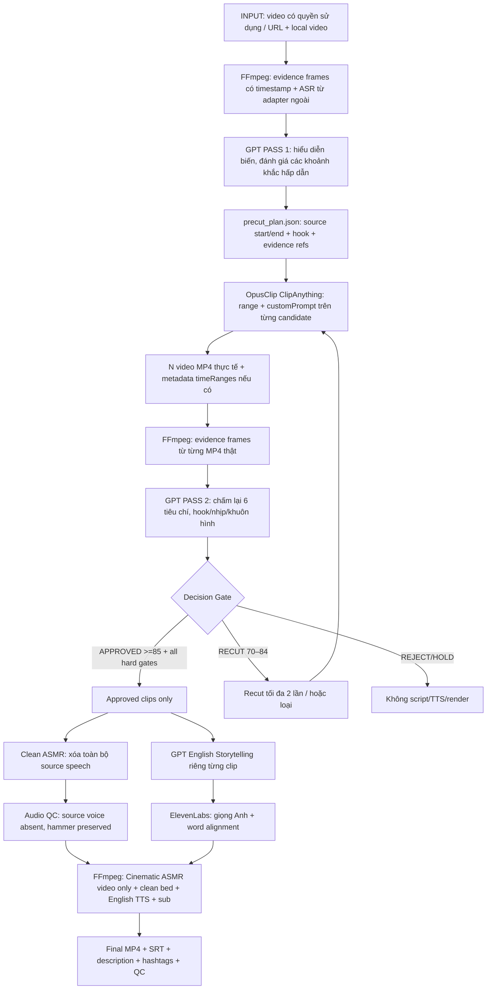

# LOCAL VIDEO FORGE v3.4 — GPT-FIRST VIRAL DIRECTOR

**Ngày:** 2026-10-17  
**Nền:** v3.3 Universal Source + Clean ASMR + Cinematic ASMR  
**Tình trạng:** SPEC + prototype Python offline + adapter HTTP tùy chọn. Không phải hệ thống một nút production hoàn chỉnh.  
**SPEC DUY NHẤT nên đọc trước:** tập tin này. `legacy_docs/SPEC_...v3.3...` chỉ là tài liệu gốc để tra các chi tiết renderer/audio chưa thay đổi.

## 0. Quyết định kiến trúc bắt buộc

**GPT phân tích nguồn TRƯỚC, OpusClip thực hiện cắt, GPT phân tích clip thành phẩm SAU, chỉ clip đạt mới được phát sinh script/TTS/render.**



### Không đổi từ v3.3

1. **Universal Source:** nguồn bất kỳ Đức/Hàn/Nhật/Trung/khác. Ngôn ngữ **không** chứng minh quốc gia. Nói tên nước khi xuất xứ đã xác minh.
2. **Giữ Clean ASMR:** loại tiếng nói nguồn trên toàn timeline, vẫn giữ tiếng gõ búa/mài/lửa xưởng; không dùng mute nền hay sidechain ducking theo giọng Anh.
3. **English Storytelling:** câu chuyện Anh độc lập theo diễn biến thực tế, không dub song song lời nguồn.
4. **ElevenLabs:** voice ID cấu hình v3.3 `QIhD5ivPGEoYZQDocuHI` (cần kiểm tra voice trong tài khoản); model voice `eleven_multilingual_v2` mặc định.
5. **Phụ đề:** 54 px/1080×1920, 85% chiều cao, 1–4 từ/cụm, SRT + ASS burn-in từ word timing thật.
6. **Cinematic ASMR:** micro-zoom ≤1.05 và grading nhẹ chỉ trên hình; không tự speed-ramp hoặc đảo cảnh khiến tiếng búa lệch frame.
7. **Rights gate:** nguồn/phần nhạc/asset cần quyền phù hợp. Nhận diện/gắn voice/sub không mặc nhiên khiến video được phép dùng hoặc được nền tảng công nhận là original.

## 1. GPT PASS 1 — phải **hiểu video** trước khi dùng OpusClip

### 1.1 Input thực tế (không chỉ link YouTube)

- File local MP4 hợp lệ hoặc upstream adapter tải/xuất media có quyền sử dụng; URL YouTube **không** tự biến thành khả năng xem mọi khung hình.
- Metadata gốc: channel/title/description/credit/license; source context nếu đã được xác minh.
- Khung hình có ID và timestamp tuyệt đối của video nguồn: `evidence_manifest.json` + JPG `frames/`.
- Transcript/ASR có timestamp nếu đã có; lời nguồn dùng làm factual evidence, không dùng để dub từng câu.
- Audio events / ASMR markers **nếu có detector riêng**; chỉ xem frame không thể xác thực tiếng búa nghe thế nào.

**Quét 2 tầng:** pass coarse 2–4 giây một frame trên toàn video; vùng tiềm năng được resample 0.5–1 giây/frame. Với động tác nhanh nên dùng video-capable model/scene-boundary/motion detection hoặc audio event analyzer. Việc cung cấp 100 ảnh tĩnh **không chứng minh** model nhìn/nhận mọi cú búa nằm giữa hai ảnh.

### 1.2 GPT đầu ra: `precut_plan.json`

```json
{
  "schema_version": "3.4", "mode": "GPT_FIRST_VIRAL_DIRECTOR",
  "source_sha256": "<sha256 của video local>",
  "source_duration_sec": 1152.0,
  "rights_status": "VERIFIED",
  "analysis_model": "<actual vision-capable API model ID>",
  "source_country_status": "UNKNOWN", "source_language": "ko",
  "production_topic_en": "Forging a Damascus blade",
  "candidates": [
    {
      "id":"C01", "start_sec": 80, "end_sec": 156, "hook_at_sec": 89.0,
      "evidence_frame_ids": ["frame_0012", "frame_0018"],
      "hook_visual": "Glowing metal receives a powerful hammer strike",
      "actions": ["heating", "hammering"],
      "hook_why": "Immediate movement and sharp visual contrast",
      "asmr_notes": "Hammer transients expected, audio still unverified",
      "narrative_arc": "Hot steel is shaped into an early blade blank",
      "potential_score": 92,
      "uncertainty_notes": "Timestamp is approximate pending denser sampling",
      "desired_clip_min_sec": 61, "desired_clip_max_sec": 90
    }
  ]
}
```

**Cứng:** ID frame phải tồn tại trong bằng chứng, interval phải nằm trong video thực và bao phủ chứng cứ tại đó; `rights_status=VERIFIED` do kiểm tra quyền sử dụng, không phải GPT tự phong. `potential_score` là heuristic để xếp thứ tự, **không** dự đoán view TikTok. Nếu chưa đủ evidence, HOLD thay vì bịa.

## 2. OPUSCLIP DIRECTED CUT

### 2.1 Thực hiện theo từng candidate

OpusClip hiện tài liệu hóa API `POST /api/clip-projects`, các thuộc tính:
- `videoUrl`: URL video có thể truy cập với quyền thích hợp.
- `curationPref.model="ClipAnything"`.
- `curationPref.range={startSec,endSec}` để Opus lựa chọn **trong vùng GPT xác định**.
- `curationPref.customPrompt` nêu hook, hành động, câu chuyện visual và tránh cảnh talking head.
- `curationPref.clipDurations=[[min,max]]` mục tiêu độ dài.
- `renderPref.layoutAspectRatio="portrait"`.

**Không được giả định** Opus buộc cắt frame-exact tại giây GPT chỉ. `range` giới hạn vùng tìm; Opus vẫn cắt theo curation riêng. Nếu yêu cầu start/end chính xác: `FFmpeg` cut theo timestamp, hoặc dùng kết quả Opus nhưng review lại. Chờ job/nhận export cần thực thi API polling/webhooks/metadata tương ứng; prototype v3.4 chỉ có submit + importer v3.3, **chưa tự tải mọi MP4 cloud**.

### 2.2 Mapping timeRange

Đối với mỗi MP4: lưu source candidate ID + `source_mapping.json` bằng data `timeRanges` gốc Opus (chỉ định rõ `SECONDS`/`MILLISECONDS`) hoặc manual editor attestation. Không tự nhận metadata ví dụ `[[192170,211630]]` là giây: đơn vị có thể là mili-giây. Code yêu cầu ≥75% thời lượng trích từ khoảng GPT đề xuất và `source_mapping` có project ID nếu bằng chứng từ Opus.

Nếu mapping chưa xác minh → **HOLD**, không cấp approval kể cả model đánh giá video đẹp.

## 3. GPT PASS 2 — **xem lại video Opus thực tế**, không tin điểm Opus

Input: chính MP4 đã xuất, frames có timestamp **trên timeline clip**, duration, aspect ratio, mapping từ nguồn, vấn đề lời source nếu ASR/video detector có.

Bảng trọng số rubric, do **GPT chấm nhưng validator tổng hợp**:

| Tiêu chí | Trọng số |
|---|---:|
| Hook trực quan trong 0–3 giây | 25% |
| Hành động cơ khí và tiềm năng ASMR (visual; audio cần QC riêng) | 25% |
| Câu chuyện có mở/diễn biến/kết quả | 20% |
| Khung 9:16, chủ thể đủ rõ | 15% |
| Nhịp dựng, ít khoảng chết | 10% |
| Có thể tạo lời kể Anh thực chất | 5% |

### 3.1 Decision

- **APPROVED:** tổng ≥85/100, và **đủ toàn bộ hard gate**.
- **RECUT:** 70–84.99 và không có hard blocker. Có thể gửi yêu cầu cho Opus/local editor để dựng lại; giới hạn 2 vòng recut/job, sau đó HOLD/REJECT.
- **REJECTED:** dưới 70, video lỗi, không có thao tác cơ khí, hook kém, frame sai 9:16, thời lượng quá ngắn theo profile.
- **HOLD:** chưa có quyền clip/nguồn, mapping chưa xác minh, model confidence dưới 0.75; cần người kiểm tra. **Không được ép qua gate tự động**.

### 3.2 Hard gates (code)

- `clip.mp4` và `clip_evidence` tồn tại, SHA-256 + duration trùng review.
- Review dẫn chính xác frame IDs có mặt trong MP4 export, ít nhất một hook frame ở 0–3 giây.
- 9:16 portrait, chủ thể, các hành động thực, diễn biến hợp lý; không có export defect nghiêm trọng.
- Model confidence ≥0.75 (ngưỡng thử nghiệm, không phải xác suất đã hiệu chuẩn).
- Cần quyền nguồn/clip, mapping timeRanges/human evidence; không lẫn xuất xứ địa lý.
- Khuyến nghị kiểm tra trùng clip SHA-256 importer; perceptual dedup trên video tương đồng **chưa triển khai**.
- Nếu pass: tạo `viral_approval.json` đóng dấu sha256 source plan / clip / review / evidence / mapping. Chỉnh sửa file sau approval làm gate mất hiệu lực.

**Lưu ý:** model chỉ xem frame tĩnh không thể nghe âm thanh; chấm `action_asmr` là *tiềm năng* của thao tác. Clean ASMR thực vẫn cần source separation + audio QC riêng sau approval.

## 4. CHẶN CHI PHÍ SAU REVIEW

```text
IMPORTED → FRAME_EVIDENCE_READY → GPT_POSTCUT_REVIEWED
    ├── APPROVED + RIGHTS + PROVENANCE → STORY_WRITING → TTS → CLEAN_ASMR → RENDER
    ├── RECUT → TRY AGAIN [MAX 2]
    ├── REJECTED → SKIP
    └── HOLD → MANUAL REVIEW; KHÔNG GỌI ELEVENLABS
```

`storytelling_render_v34.py` là **entrypoint được phép dùng**. Nó gọi `assert_approved()` trước khi thực hiện toàn bộ `storytelling_render_v33.process`, nhờ đó bảo toàn Clean ASMR/Sub/Cinematic đã được test từ v3.3. `storytelling_render_v33.py` chỉ là module lõi tương thích, **không chạy trực tiếp trong production** vì chưa chứa viral gate.

**Adapter ElevenLabs / story-generation bên ngoài cũng phải gọi `assert_approved()` trước khi tính tiền hoặc tạo output.** Package hiện không có endpoint TTS/ASR/separation live và cũng không tự chạy 1-button pipeline.

## 5. Ví dụ công việc local

```bash
pip install -r requirements.txt
# Chỉ đối với media đã được cấp quyền và có local file:
python prepare_video_evidence_v34.py --video /assets/source.mp4 --output-dir /work/source_evidence --kind SOURCE --step-sec 3 --max-frames 120

# GPT PASS 1: OPENAI_API_KEY + model vision thật mà API account cho phép:
python gpt_vision_adapter_v34.py precut --source-evidence /work/source_evidence/evidence_manifest.json --output /work/precut_plan.json --model "$OPENAI_VISION_MODEL" --topic 'Knife forging'
# OUTPUT rights_status UNKNOWN: biên tập viên xác minh quyền rồi cập nhật VERIFIED.
# GPT candidate timeline có thể refine bằng --windows-json [[start,end],...], --step-sec 0.5.

# Sinh request jobs sau khi quyền nguồn VERIFIED:
python director_workflow_v34.py opus-jobs --precut /work/precut_plan.json --source-evidence /work/source_evidence/evidence_manifest.json --source-url 'https://www.youtube.com/watch?v=...' --output /work/opus_jobs.json

# Xem dry-run, hoặc thực sự submit (tính phí theo Opus):
python director_workflow_v34.py submit-opus --jobs /work/opus_jobs.json --output /work/opus_job_results.json
# OPUSCLIP_API_KEY=... python director_workflow_v34.py submit-opus --jobs ... --output ... --execute

# Sau khi đã nhận/export MP4 từ Opus: nhập theo v3.3:
python ingest_opus_batch_v33.py --clips-dir /work/opus_exports --output-root /work/clips --rights-reviewed
# Bên trong /work/clips/clip_001... có clip.mp4; cần giữ candidate_id và source mapping metadata.

python prepare_video_evidence_v34.py --video /work/clips/clip_001/clip.mp4 --output-dir /work/clips/clip_001/clip_evidence --kind OPUS_CLIP --step-sec 1 --max-frames 80
python gpt_vision_adapter_v34.py review --clip-evidence /work/clips/clip_001/clip_evidence/evidence_manifest.json --output /work/clips/clip_001/postcut_review.json --candidate-id C01 --model "$OPENAI_VISION_MODEL"
# GPT draft giữ content_rights_reviewed=false; editor sau khi review media/asset bản xuất và provenance,
# xác nhận thông tin và đổi true. source_mapping.json lấy từ Opus provider metadata hoặc editor.

python director_workflow_v34.py decide --clip-folder /work/clips/clip_001 --review /work/clips/clip_001/postcut_review.json --clip-evidence /work/clips/clip_001/clip_evidence/evidence_manifest.json --precut /work/precut_plan.json --source-evidence /work/source_evidence/evidence_manifest.json
python director_workflow_v34.py gate --clip-folder /work/clips/clip_001

# Chỉ sau khi APPROVED, tiếp tục tạo story_plan.json v3.3 + workshop bed + TTS + QC.
python storytelling_render_v34.py check --folder /work/clips/clip_001
python storytelling_render_v34.py process --folder /work/clips/clip_001
```

### `source_mapping.json` mẫu (Opus source range, ms)

```json
{
  "schema_version":"3.4", "source_candidate_id":"C01",
  "verified_by":"OPUS_PROVIDER", "opus_project_id":"project-xxx",
  "source_time_ranges":[[84000,147000]], "time_unit":"MILLISECONDS",
  "evidence_note":"Original export timeRanges returned by Opus API"
}
```

`--execute` mới thực gửi request Opus và có thể tiêu tốn credits; dry-run mặc định. `gpt_vision_adapter_v34.py` khi chạy sẽ gọi OpenAI Responses API thực và có thể phát sinh phí; không có API key/model hợp lệ thì lỗi rõ ràng. Video local và YouTube URL phải là cùng một nguồn, nếu khác hash không chứng minh tương ứng—cần xác nhận ở upstream.

## 6. Cấu trúc kết quả

```text
source_job/
├── source_evidence/evidence_manifest.json + frames/
├── precut_plan.json                # GPT pass 1 output, model không tự verify rights
├── opus_jobs.json                  # source ranges + ClipAnything custom prompts
├── opus_job_results.json          # optional API submit response
└── clips/
    ├── clip_001_.../
    │   ├── clip.mp4
    │   ├── clip_evidence/evidence_manifest.json + frames/
    │   ├── source_mapping.json
    │   ├── postcut_review.json     # GPT pass 2 actual export score
    │   ├── viral_approval.json     # APPROVED / RECUT / REJECTED / HOLD
    │   ├── source_plan_pointer.json
    │   ├── story_plan.json         # only after approval
    │   ├── audio/workshop_clean.wav + replacement_qc.json
    │   ├── audio/tts/...
    │   ├── effect_plan.json
    │   ├── final.mp4
    │   ├── subtitles.srt / subtitles.ass
    │   └── publication/...
    └── clip_002_.../
```

## 7. Acceptance & giới hạn

**Bắt buộc chứng minh bằng tests:** 
- Candidate không tồn tại frame hoặc vượt timestamp bị từ chối.
- Không dispatch nếu rights_status chưa VERIFIED.
- Opus receives range+ClipAnything prompt (không tuyên bố exact cutting).
- Không có `viral_approval.json` → renderer v3.4 từ chối.
- Điểm cao nhưng `source_mapping.json` thiếu/không khớp → HOLD.
- Điểm 70–84 → RECUT; <70 → REJECT.
- Clip đã approved nhưng bị thay nội dung → STALE_APPROVAL.
- Duy trì v3.3 source-language neutral, clean stem QC, typography, visual-only effects.

**Đã code:** trích frames timestamp, schema pre-cut/post-cut, GPT Responses image adapter optional, Opus project submit optional, scoring/decision, stale hash checks, v3.4 renderer gate wrapper, test fixtures.  
**Chưa code/verify live end-to-end:** YouTube downloader và quyền sử dụng; ASR/music event live; tự tải/poll mọi export Opus với time-range mapping; nhận dạng action và motion liên tục từ native video; automatic recut adapter + retry persistence; ElevenLabs TTS / SAM Audio tách giọng; social publishing; perceptual dedup; trên các media thực tế không thể khẳng định 100% khử giọng mà giữ mọi transient. API shape tùy có thể thay đổi—kiểm tra lại với tài khoản của bạn.

**Ý nghĩa của v3.4:** quyền quyết định tiền kỳ và hậu kỳ cắt video thuộc về GPT + validator, không phải quyết định mặc định của OpusClip. **Không thể gọi là full automation** cho đến khi các adapter/dữ liệu bắt buộc nói trên được nối và test trên footage thật.

## 8. Event Evidence phụ trợ v3.4

Module `video_event_evidence_v34.py` hỗ trợ chạy FFmpeg đánh dấu **cắt cảnh thị giác** và phép đo **đỉnh năng lượng audio chưa phân loại**. Nó không khẳng định nghe được tiếng búa hay phát hiện giọng người. Mốc thời gian được ràng bằng SHA của file nguồn.

```bash
python video_event_evidence_v34.py --video /assets/source.mp4 --output /work/source_events.json
python gpt_vision_adapter_v34.py precut --source-evidence /work/source_evidence/evidence_manifest.json --events-json /work/source_events.json --output /work/precut_plan.json --model "$OPENAI_VISION_MODEL" --topic 'Damascus knife forging'
```

Với sự kiện dồn dập, hãy trích dày frame của chính các cửa sổ đó trước khi chốt điểm vào/ra. Việc có đỉnh năng lượng audio không chứng minh một cú búa thật; tiếng nói, nhạc và noise đều có thể tạo onset.
